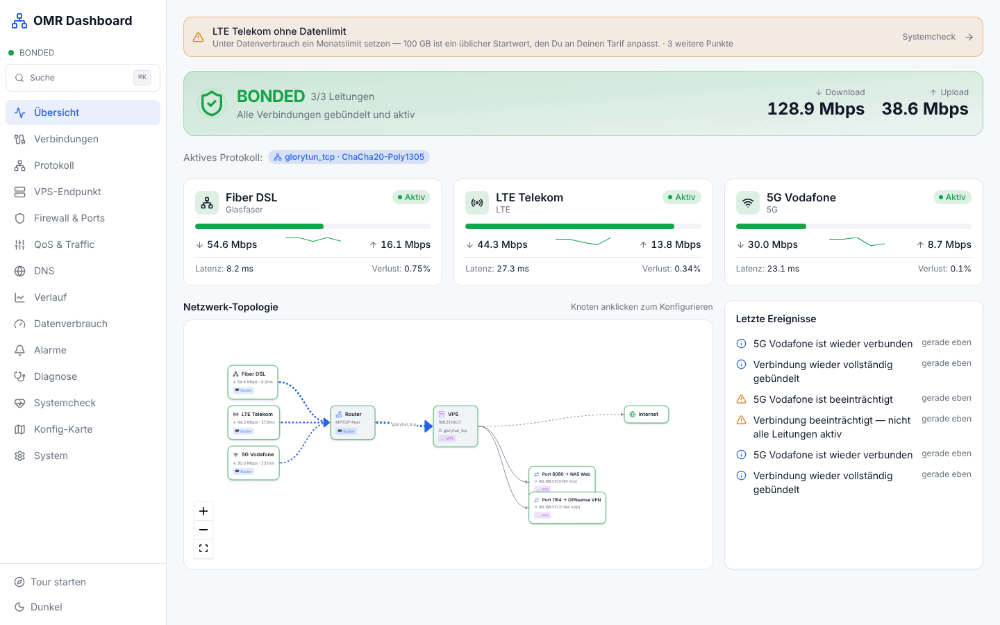
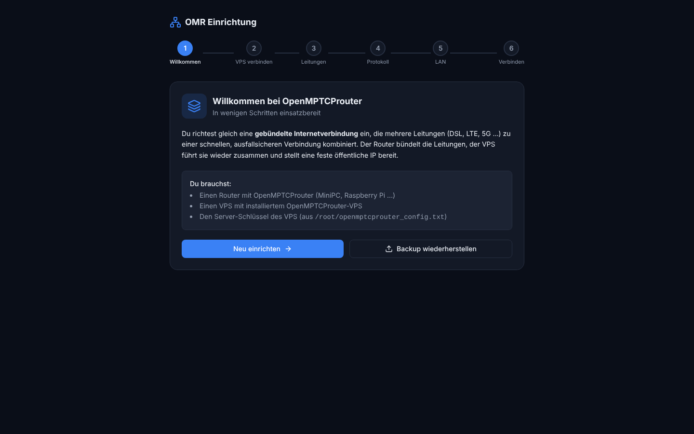
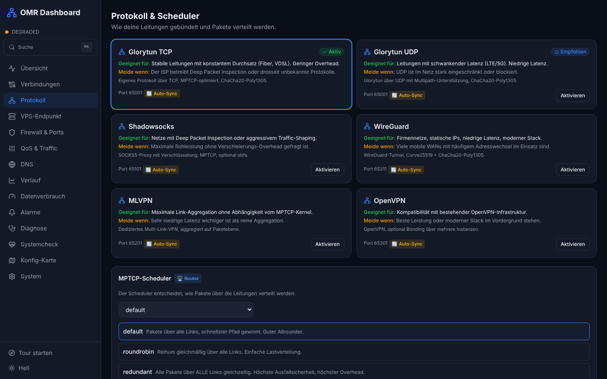
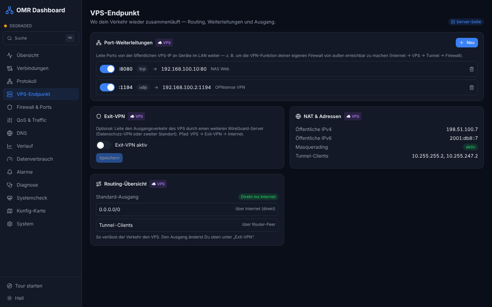
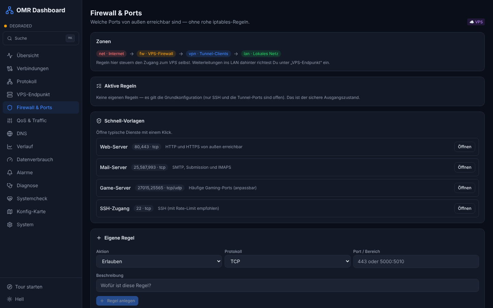
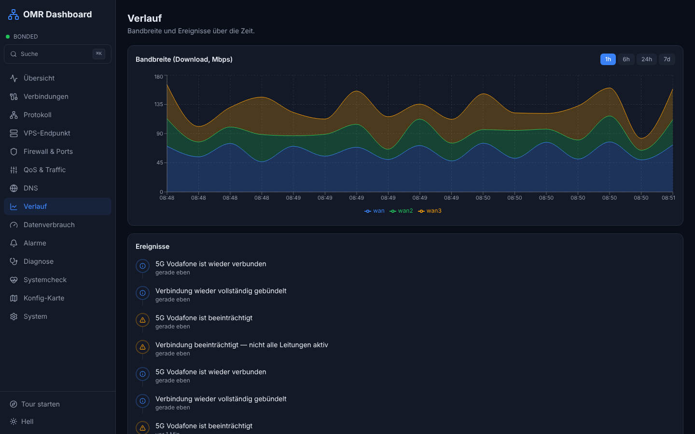
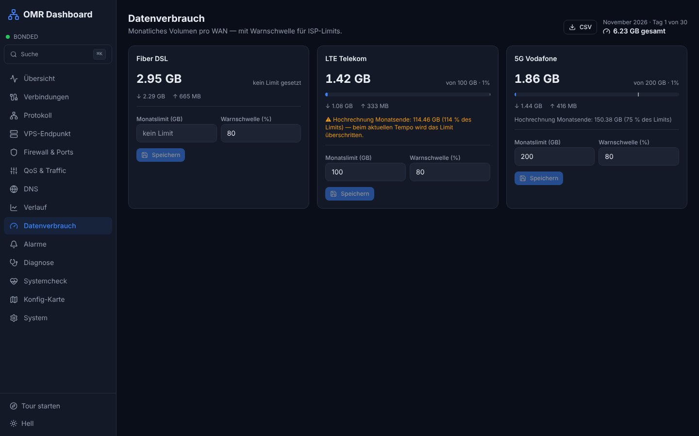
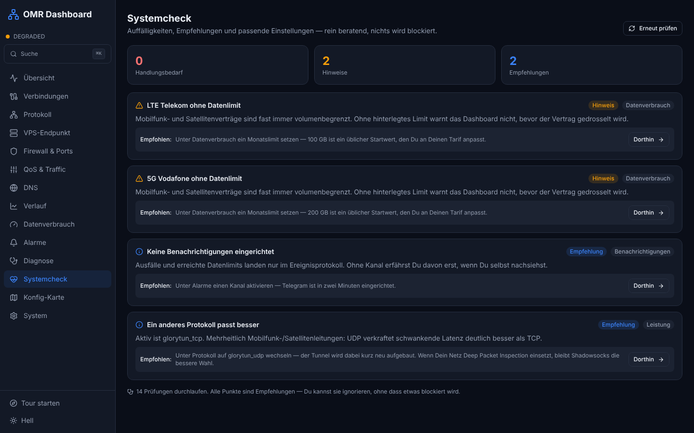
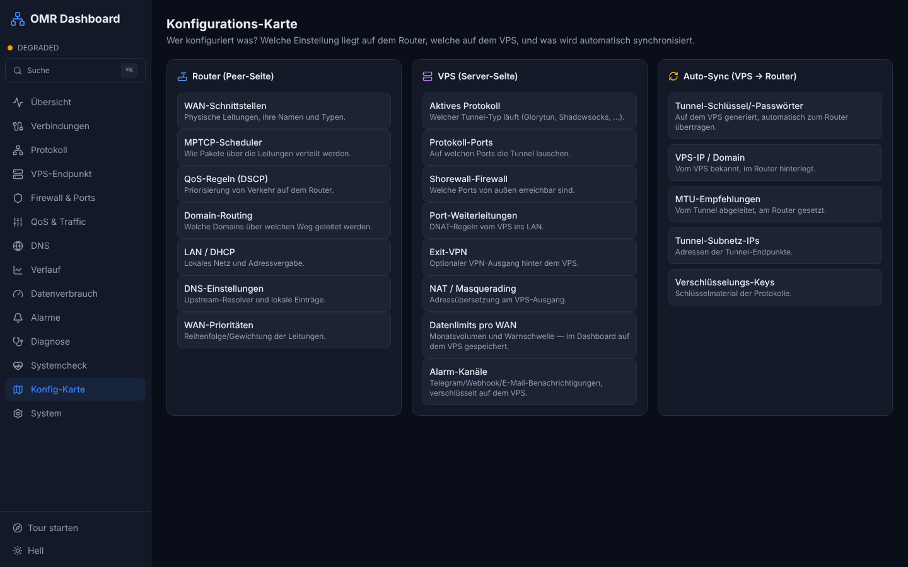
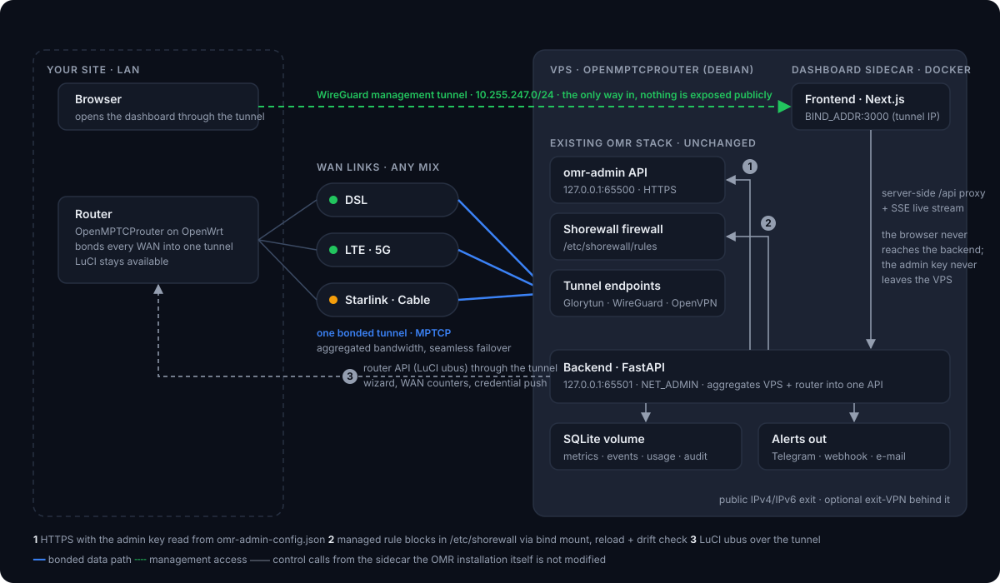

<p align="center">
  <picture>
    <source media="(prefers-color-scheme: dark)" srcset="docs/img/logo-dark.svg">
    
  </picture>
</p>

<p align="center">
  A friendly control panel for <a href="https://github.com/Ysurac/openmptcprouter">OpenMPTCProuter</a> —
  bonding status at a glance, a guided setup wizard, alerts and data caps.<br>
  Runs as a <b>Docker sidecar on your existing OMR VPS</b>. The OMR installation itself is not modified.
</p>

<p align="center">
  <a href="https://github.com/ConGp20/omr-dashboard/actions/workflows/ci.yml"></a>
  
  
  
  
  
  
</p>

<p align="center">
  <a href="#install">Install</a> ·
  <a href="#architecture">Architecture</a> ·
  <a href="#screenshots">Screenshots</a> ·
  <a href="#configuration">Configuration</a> ·
  <a href="#development">Development</a> ·
  🇩🇪 <a href="INSTALL.de.md">Deutsche Anleitung</a> ·
  🧪 <a href="docs/erster-test.de.md">Erster Hardware-Test</a>
</p>

<p align="center">
  <picture>
    <source media="(prefers-color-scheme: dark)" srcset="docs/img/screens/dashboard.png">
    
  </picture>
</p>

---

## Why

OpenMPTCProuter is technically excellent at bonding DSL, LTE, 5G or Starlink into
one fast, failover-safe connection. Operating it means LuCI pages, the `omr-admin`
API, Shorewall files and a handful of keys spread across router and VPS.

OMR Dashboard puts all of that behind one clean UI — a Speedify/SpeedFusion-style
experience on top of the stack you already run:

- **Purely additive.** Installs next to a working OMR VPS as two Docker containers.
  No OMR file is patched, LuCI keeps working, uninstalling is `docker compose down`.
- **One API, both sides.** The backend talks to `omr-admin` on the VPS and to the
  router's LuCI/ubus API, and merges them into a single picture.
- **Not exposed.** You reach it through the WireGuard management tunnel OMR already
  sets up — nothing new is opened on the public interface.

## Highlights

| | |
|---|---|
| 🧭 **Guided setup wizard** | Connect the VPS, auto-detect WAN links, choose a protocol in plain language — the dashboard pushes keys and credentials to the router. No copying by hand. |
| 📡 **Live overview** | BONDED / DEGRADED / OFFLINE, aggregated throughput, per-link cards with latency and loss, an interactive topology you can click through, recent events. |
| 🔌 **Protocol & scheduler** | Glorytun TCP/UDP, Shadowsocks, WireGuard, MLVPN, OpenVPN — each with *good for / avoid when*, one-click switch, MPTCP scheduler explained. |
| 🛡️ **Firewall & port forwarding** | Shorewall rules and DNAT without touching iptables; quick templates; managed blocks survive OMR updates and can be restored with one click. |
| 🌐 **VPS endpoint** | Port forwards into the LAN (e.g. expose your own firewall's VPN through the VPS), exit-VPN behind the VPS, NAT and routing overview. |
| 📊 **History & data caps** | Bandwidth history per link; monthly volume per WAN from the router's counters with cap, warning threshold and a month-end projection that flags an overrun before it happens. |
| 🔔 **Alerts** | Telegram, webhook or e-mail when a line drops, the bond goes offline or a cap is reached. Cooldown keeps a flapping link from flooding you. |
| 🩺 **System check** | Non-blocking advice: misconfiguration hints and recommendations with the exact setting to change and a link straight to it. Nothing it reports ever blocks an action. |
| 🗺️ **Config map** | Which setting lives on the router, which on the VPS, and what is auto-synced. |
| 🔐 **Security basics** | Login with throttling, httpOnly session cookie, encrypted alert secrets, audit log, encrypted backup/restore of the whole configuration. |
| ✨ **Polish** | Dark/light theme, ⌘K command palette, onboarding tour, SSE live updates. UI in German. |

## Screenshots

<table>
  <tr>
    <td width="50%"><br><sub><b>Setup wizard</b> — six steps from "connect the VPS" to a running bond; keys are transferred for you.</sub></td>
    <td width="50%"><br><sub><b>Protocol & scheduler</b> — every option explained in plain language, with a recommendation for your link mix.</sub></td>
  </tr>
  <tr>
    <td><br><sub><b>VPS endpoint</b> — port forwards into the LAN, exit-VPN, NAT and routing at a glance.</sub></td>
    <td><br><sub><b>Firewall & ports</b> — Shorewall zones, quick templates and custom rules without raw iptables.</sub></td>
  </tr>
  <tr>
    <td><br><sub><b>History</b> — per-link bandwidth over 1h to 7d, plus the event log.</sub></td>
    <td><br><sub><b>Data usage</b> — monthly volume per WAN with cap, warning threshold and month-end projection.</sub></td>
  </tr>
  <tr>
    <td><br><sub><b>System check</b> — hints and recommendations that link to the setting in question; never blocking.</sub></td>
    <td><br><sub><b>Config map</b> — router side, VPS side, and what is synced automatically.</sub></td>
  </tr>
</table>

## Architecture

<p align="center"></p>

- **Frontend** (`frontend/`) — Next.js 16 App Router, Tailwind, ReactFlow for the
  topology, Recharts for history. The browser only ever talks to the Next.js
  server, which proxies `/api` to the backend server-side. The backend therefore
  stays on `127.0.0.1`, and the `omr-admin` key never reaches a browser.
- **Backend** (`backend/`) — FastAPI. Polls VPS and router every 10 s (in step
  with `omr-service`) into a SQLite store, streams updates over SSE, and wraps the
  existing APIs: `omr-admin` over HTTPS with the server key, the router over LuCI
  ubus through the tunnel, Shorewall through managed blocks in `/etc/shorewall`.
- **Update-safe.** The SQLite schema is versioned (`PRAGMA user_version`); an OMR
  upgrade that regenerates the Shorewall rules is detected by the system check and
  repaired with one click from the dashboard's own snapshot.

### Security model

1. Set `BIND_ADDR` to your WireGuard tunnel IP (e.g. `10.255.247.1`). The frontend
   listens there only; the backend listens on `127.0.0.1`.
2. Shorewall does **not** open ports 3000/65501 to the internet, and nothing new has to be opened.
3. From behind the router you are inside the tunnel network, so
   `http://10.255.247.1:3000` just works. Before the tunnel exists, use an SSH
   tunnel: `ssh -L 3000:127.0.0.1:3000 root@<vps>`.
4. Login is required outside demo mode (password defaults to the `omr-admin` key),
   with per-IP throttling and an httpOnly session cookie.

## Install

### Try it first (demo, no VPS needed)

```bash
git clone https://github.com/ConGp20/omr-dashboard.git
cd omr-dashboard
docker compose -f docker-compose.dev.yml up
# open http://localhost:3000
```

Synthetic data, every page clickable, no login.

### On an existing OMR VPS

```bash
git clone https://github.com/ConGp20/omr-dashboard.git /opt/omr-dashboard
cd /opt/omr-dashboard
./install.sh --bind 10.255.247.1       # your WireGuard tunnel IP
```

`install.sh` detects the `omr-admin` server key from the existing
`omr-admin-config.json`, writes `.env`, installs Docker if it is missing, builds
both images and starts the stack. All flags: `./install.sh --help`
(`--router-pass`, `--dashboard-pass`, `--demo`, `--no-start`, `--force`, …).

A **fresh** VPS can pull the dashboard in during the OMR VPS install with
`DASHBOARD=yes`; see [`INSTALL.de.md`](INSTALL.de.md) for that path and a full
step-by-step guide in German.

### Upgrade

```bash
cd /opt/omr-dashboard && git pull && ./install.sh
```

`.env` and the data volume are kept; schema migrations run on first start.
Dependabot keeps dependencies and base images current via pull requests.

## Configuration

`install.sh` writes `.env`; edit it and run `docker compose up -d` to apply.

| Variable | Meaning | Default |
|---|---|---|
| `OMR_ADMIN_KEY` | Server key of this VPS, used against `omr-admin` on port 65500 | auto-detected |
| `ROUTER_IP` / `ROUTER_USER` / `ROUTER_PASS` | LuCI credentials for WAN detection, counters and key push | `192.168.100.1` / `root` / – |
| `BIND_ADDR` | Address the frontend listens on — your tunnel IP | `127.0.0.1` |
| `DASHBOARD_PASS` | Dashboard login password | falls back to `OMR_ADMIN_KEY` |
| `JWT_SECRET` | Signs session cookies — change it | placeholder (the system check will remind you) |
| `OMR_DASHBOARD_DEMO` | Synthetic data, no VPS/router needed | `false` |

Alert channels (Telegram, webhook, SMTP) and per-WAN data caps are configured in
the UI and stored encrypted in the data volume.

## Pages at a glance

| Page | What you do there | Lives on |
|---|---|---|
| Übersicht | Bond state, throughput, link cards, topology, recent events | — |
| Verbindungen | Name, type, priority and enable/disable per WAN | Router |
| Protokoll | Tunnel protocol and MPTCP scheduler, explained | VPS → Router |
| VPS-Endpunkt | Port forwards into the LAN, exit-VPN, NAT, routing | VPS |
| Firewall & Ports | Shorewall rules with templates; drift restore | VPS |
| QoS & Traffic | QoS profiles; domain routing via VPN, a specific WAN, or block | Router |
| DNS | Upstream resolvers, DoH/DoT, local entries | Router |
| Verlauf | Bandwidth history and event log | — |
| Datenverbrauch | Monthly volume, caps, projection, CSV export | VPS (dashboard) |
| Alarme | Telegram / webhook / e-mail channels, test send | VPS (dashboard) |
| Diagnose | Ping to router and VPS, speed test, protocol fine-tuning hints | — |
| Systemcheck | Hints and recommendations, non-blocking | — |
| Konfig-Karte | Where each setting is stored | — |
| System | Connection settings, versions, backup/restore, audit log | — |

## Development

```bash
# backend
cd backend && python3 -m venv .venv && . .venv/bin/activate
pip install -r requirements.txt pytest
OMR_DASHBOARD_DEMO=true uvicorn omr_dashboard_api:app --port 65501

# frontend (second shell)
cd frontend && npm ci
BACKEND_URL=http://127.0.0.1:65501 npm run dev
```

Tests and checks — the same ones CI runs on every push and pull request:

```bash
cd backend && OMR_DASHBOARD_DEMO=true pytest     # 169 tests: demo + real-mode units
pip-audit -r requirements.txt --no-deps
cd ../frontend && npx tsc --noEmit && npm run build && npm audit --audit-level=high
```

CI additionally builds both Docker images from a clean checkout. Dependabot opens
weekly grouped PRs for pip, npm, both base images and the actions.

```
backend/      FastAPI app, services (omr-admin, router, shorewall, advisor, alerts,
              usage, metrics store with versioned migrations), 169 tests
frontend/     Next.js app: pages per feature, server-side /api proxy, SSE stream
docs/         German guides: first hardware test, routing plan; images
install.sh    Installer for an existing OMR VPS
docker-compose.yml       production stack (host network, NET_ADMIN for Shorewall)
docker-compose.dev.yml   demo stack with hot reload
```

## Limitations

- OpenMPTCProuter bonds all WANs to **one** VPS. Multi-VPS failover across
  locations (as in Speedify) is not a thing here; a second WireGuard server can be
  chained as an **exit-VPN** behind the primary VPS.
- The UI is German. The code, API and this README are English.
- The first test against real hardware is documented in
  [`docs/erster-test.de.md`](docs/erster-test.de.md); everything else is covered by
  the automated tests and a browser smoke test of the full install.

## Documentation

- 🇩🇪 [`INSTALL.de.md`](INSTALL.de.md) — complete installation guide: demo, VPS
  install, tunnel access, wizard walkthrough, troubleshooting, backups.
- 🧪 [`docs/erster-test.de.md`](docs/erster-test.de.md) — first test on real
  hardware, step by step, with what success looks like and which logs help.
- 🧭 [`docs/routing-plan.de.md`](docs/routing-plan.de.md) — routing plan for a
  site with its own firewall behind the OMR router.

---

<p align="center"><sub>Built on top of <a href="https://github.com/Ysurac/openmptcprouter">OpenMPTCProuter</a> by Ycarus — this project is an independent usability layer and not affiliated with it.</sub></p>
